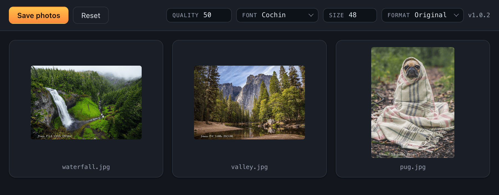
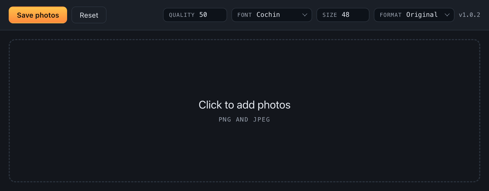

<div align="center">


# EXIF on your photo 📸

**Burn your camera settings onto the photo, the way film labs used to print them.**

Drop a batch of photos, pick a typeface and save copies with focal length, aperture, shutter speed and ISO printed on them.

<!-- prettier-ignore-start -->
[](https://github.com/piecioshka/exif-on-your-photo/actions/workflows/ci.yml)
[](https://github.com/piecioshka/exif-on-your-photo/actions/workflows/release.yml)
[](https://github.com/piecioshka/exif-on-your-photo/releases/latest)
[](#requirements-)
[](https://www.electronjs.org/)
[](https://piecioshka.mit-license.org)
<!-- prettier-ignore-end -->

</div>



## Features ✨

- 📷 Reads focal length, aperture, shutter speed and ISO straight out of the file's EXIF
- 🖋️ Prints them onto the photo in one of four serif faces _(Cochin, Baskerville, Didot, Optima)_
- 📐 Keeps the original dimensions or scales down to Full HD
- 🎚️ Caption size and JPEG quality are yours to set
- 🗂️ Takes a whole batch at once, every photo with its own preview
- 💾 Writes to a `WITH_EXIF` directory next to the originals, which stay untouched
- 🔌 Works entirely offline _(nothing is uploaded, no account, no telemetry)_
- 🛡️ Sandboxed renderer with no access to Node.js

## Screenshots 📸



[Watch the 30 second demo](./demo/demo.mp4) to see a batch go through every typeface, a caption size change and a save.

## Requirements 💻

- macOS (Apple Silicon or Intel), Windows or Linux

The four caption faces ship with macOS. Elsewhere the system substitutes whatever serif it has, so the captions stay readable but the lettering differs.

## Installation 📦

Download the file for your system from the [latest release](https://github.com/piecioshka/exif-on-your-photo/releases/latest):

| System  | File                                                                       |
| ------- | -------------------------------------------------------------------------- |
| macOS   | `*-arm64.dmg` for Apple Silicon, `*.dmg` without an architecture for Intel |
| Windows | `*.Setup.*.exe` (installer) or the other `*.exe` (portable)                |
| Linux   | `*.AppImage` or `*.deb` (`amd64`/`x64` for Intel and AMD, `arm64` for ARM) |

> [!NOTE]
>
> The builds are not signed with a paid certificate. macOS needs one extra step on the first launch (see below), and Windows shows a SmartScreen warning, where "More info" reveals the "Run anyway" button.

### Opening on macOS

The app is not notarized by Apple, so macOS blocks the first launch:

1. Open **EXIF on your photo** from Applications, then close the warning.
2. Open **System Settings** > **Privacy & Security**, scroll down and click **Open Anyway** next to EXIF on your photo.
3. Confirm with **Open**.

Or, from the Terminal:

```bash
xattr -dr com.apple.quarantine "/Applications/EXIF on your photo.app"
```

macOS remembers the choice, so later launches start normally.

## Contributing 🛠️

Building from source, tests and releases are described in [CONTRIBUTING.md](CONTRIBUTING.md).

## License 📄

[The MIT License](https://piecioshka.mit-license.org) @ 2026
